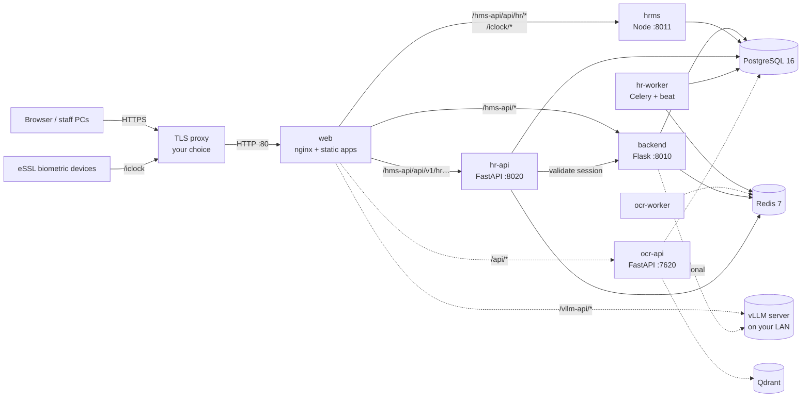
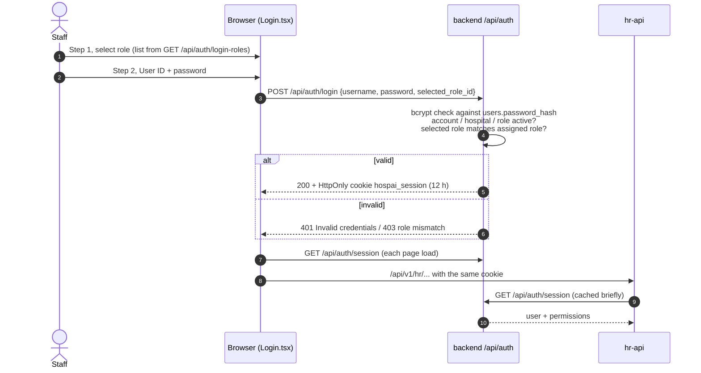

# EHMS — Deployment & System Guide

End-to-end reference for deploying and operating the HospAI Enterprise Hospital Management
System (EHMS): what runs, how requests flow, every database, configuration, deployment steps,
backups and operations.

> **Audience:** engineers and operators who deploy, run or maintain EHMS.
> **Last verified:** 2026-11-09. The full stack, including the OCR profile, was built and run
> with Docker Compose. Login, sessions, hr-api SSO, routing, OCR startup and the admin-bootstrap
> rules were all tested through the public nginx entry point.

---

## Contents

1. [Architecture at a glance](#1-architecture-at-a-glance)
2. [Services](#2-services)
3. [Request routing](#3-request-routing)
4. [Databases & storage](#4-databases--storage)
5. [Authentication end to end](#5-authentication-end-to-end)
6. [Configuration (`.env`)](#6-configuration-env)
7. [Deploying](#7-deploying)
8. [Operations: updates, backups, logs](#8-operations-updates-backups-logs)
9. [Local development](#9-local-development)
10. [Security checklist](#10-security-checklist)
11. [Known limitations](#11-known-limitations)
12. [Changes in this release](#12-changes-in-this-release)

---

## 1. Architecture at a glance



Solid lines are the **core stack**, which always runs. Dotted lines are **optional**: Keppler OCR
(compose profile `ocr`) and an external AI server.

Only the `web` container publishes a port. Every other service is reachable only on the private
Docker network `ehms`.

---

## 2. Services

| Service | Image / Dockerfile | Port | Code | Purpose |
|---|---|---|---|---|
| `web` | `deploy/web.Dockerfile` | 80 (published) | `frontend/`, `ocr-frontend/`, `deploy/nginx/` | nginx. Serves the hospital SPA and the OCR UI, and reverse-proxies all API paths |
| `backend` | `deploy/backend.Dockerfile` | 8010 | `backend/backend/` | Core hospital API: auth, admin/RBAC, patients, OPD, ER, IPD/beds, ICU, OT, EMR, lab/radiology, pharmacy, billing, accounts/GL, messaging, AI. One Flask app (`app.py`) registering all module blueprints, served by gunicorn |
| `hrms` | `deploy/hrms.Dockerfile` | 8011 | `frontend/server/` | Legacy Node HR server: `/api/hr/*` (employees, shifts, attendance, leave, payroll, credentials) and the eSSL `/iclock` push endpoint |
| `hr-api` | `deploy/hr-api.Dockerfile` | 8020 | `backend/hr-api/` | HR & Workforce API (FastAPI, `/api/v1/hr…`). Runs Alembic migrations at start |
| `hr-worker` | same image as `hr-api` | — | `backend/hr-api/app/worker.py` | Celery worker + beat: biometric polling, outbox relay, device health |
| `postgres` | `postgres:16-alpine` | 5432 (internal) | `deploy/postgres/init-databases.sh` | All four databases, one login role each |
| `redis` | `redis:7-alpine` | 6379 (internal) | — | Rate limits, Celery broker, HR caches. Password protected, AOF persistence |
| `ocr-api` *(profile `ocr`)* | `deploy/ocr.Dockerfile` | 7620 | `ocr-backend/` | Keppler OCR: document OCR, summarizer, RAG assistant, vault |
| `ocr-worker` *(profile `ocr`)* | same image as `ocr-api` | — | `ocr-backend/workers/` | OCR background jobs |
| `qdrant` *(profile `ocr`)* | `qdrant/qdrant:v1.12.4` | 6333 (internal) | — | Vector store for OCR RAG |

Image sizes as built: backend 1.6 GB (includes faster-whisper, opencv, lightrag), hr-api 390 MB,
hrms 250 MB, web 95 MB, ocr 4.3 GB (CPU torch, transformers, ultralytics). On its **first start**
`ocr-api` downloads its embedding/reranker models from Hugging Face into the `ocr-models` volume.
This needs outbound internet access once; later starts reuse the cache.

**Containers run as non-root users** (uid 10001/10003/10004, and `node` for hrms), with
`no-new-privileges` and log rotation (10 MB × 5 files).

---

## 3. Request routing

All browser traffic goes to `web`. The table mirrors the dev proxy in `frontend/vite.config.ts`,
so production behaves like local development.

| Path | Goes to | Notes |
|---|---|---|
| `/` and any app route | static SPA (`frontend/dist`) | `index.html` fallback; `/assets/*` cached for 1 year (hashed filenames) |
| `/hms-api/api/hr/*` | `hrms:8011` | `/hms-api` prefix stripped. `/hms-api/api/hr/events` is unbuffered (SSE) |
| `/iclock/*` | `hrms:8011` | eSSL biometric device push. Point devices at `https://<host>/iclock` |
| `/hms-api/api/v1/(hr\|attendance\|workforce\|payroll\|recruitment\|onboarding\|training\|performance\|compliance\|me\|reports/hr\|facility\|team)…` | `hr-api:8020` | Prefix stripped. `…/attendance/live/stream` is unbuffered (SSE) |
| `/hms-api/*` (everything else) | `backend:8010` | Prefix stripped |
| `/keppler-ocr/*` | static OCR UI | Embedded in the hospital app as an iframe |
| `/api/*` | `ocr-api:7620` | 502 when the `ocr` profile is not running |
| `/vllm-api/*` | `$VLLM_UPSTREAM` | Browser-side LLM calls; 503 when not configured |
| `/healthz` | nginx | Liveness probe |

Upload limit: 200 MB (matches Flask `MAX_CONTENT_LENGTH`). Proxy timeout: 300 s (SSE streams 1 h).

Upstreams are resolved per request through Docker DNS, so nginx starts even when an optional
service is down.

---

## 4. Databases & storage

One PostgreSQL 16 server holds **four databases**. Each has its own login role, which owns only
that database. `deploy/postgres/init-databases.sh` creates them **once**, on the first start
with an empty data volume.

| Database | Owner role | Used by | Tables | Schema management |
|---|---|---|---|---|
| `hospai` | `hms` | backend | 110 | Created and upgraded by the backend at startup (`init_database()` in `utils/database.py` and `modules/accounts/schema.py`: idempotent `CREATE TABLE IF NOT EXISTS` plus in-code migrations) |
| `hospai_hr` | `hr_owner` (migrations), `hr_app` (runtime) | hr-api, hr-worker | 78 (+76 RLS policies) | Alembic `backend/hr-api/alembic/versions/0001…0005`, applied by `python -m app.bootstrap` on every hr-api start |
| `hospai_enterprise` | `hrms_legacy` | hrms (Node) | 31 | `frontend/server/db/schema.sql`, re-runnable, applied at hrms start |
| `keppler` | `ocr` | ocr-api, ocr-worker | 8 (7 + `alembic_version`) | Alembic `ocr-backend/alembic/versions`, applied at ocr-api start |

All databases use `scram-sha-256` password authentication. Roles cannot connect to databases they
don't own. The exception is `hospai_hr`, where the runtime role `hr_app`, created by migration
0001, is restricted by row-level security and table grants.

### 4.1 `hospai`: main hospital database (110 tables)

| Domain | Tables |
|---|---|
| Platform, access & audit | `hospitals`, `hospital_settings`, `users`, `sessions`, `hospital_roles`, `audit_logs`, `emr_access_logs`, `notification_configs` |
| Masters & scheduling | `department_master`, `clinical_specialties`, `doctors`, `doctor_schedules`, `scheduling_rules`, `hospital_rooms`, `diagnostic_tariffs`, `lab_vendors` |
| Patients & registration | `patients`, `patient_card_tokens`, `patient_consents`, `patient_feedback`, `patient_messages`, `patient_movements`, `medical_history`, `documents`, `certificates`, `bulk_import_jobs` |
| OPD & appointments | `appointments`, `opd_queue`, `op_timeline` |
| Clinical / EMR | `encounters`, `clinical_notes`, `clinical_orders`, `diagnosis_records`, `care_plans`, `diagnostics`, `patient_vitals`, `nursing_notes`, `observation_notes`, `medication_schedules`, `clinical_document_embeddings` |
| Emergency | `er_visits`, `er_triage`, `er_triage_config`, `er_vitals`, `er_treatments`, `er_clinical_notes`, `er_complaints`, `er_disposition`, `er_incident_history`, `er_bed_requests`, `emergency_triage`, `ambulances`, `ambulance_dispatch` |
| Inpatient & beds | `admissions`, `bed_master`, `bed_allocations` |
| ICU | `icu_monitoring`, `icu_flowsheets`, `icu_infusions`, `icu_io_records`, `icu_lab_results`, `icu_rass_scores`, `icu_ventilator_settings`, `icu_consults` |
| Operation theatre | `ot_theatres`, `ot_cases`, `ot_surgeries` |
| Pharmacy | `pharmacy_inventory`, `pharmacy_prescriptions`, `pharmacy_sales`, `pharmacy_purchases`, `pharmacy_suppliers` |
| Billing & insurance | `invoices`, `invoice_items`, `invoice_payments`, `insurance_claims`, `insurance_verifications`, `doctor_payouts`, `vendor_payments` |
| Accounts / general ledger | `gl_accounts`, `gl_journals`, `gl_journal_lines`, `gl_vouchers`, `gl_periods`, `gl_fiscal_years`, `gl_cost_centres`, `gl_budgets`, `gl_tax_codes`, `gl_open_items`, `gl_allocations`, `gl_bank_reconciliation`, `gl_cash_sessions`, `gl_sequences`, `gl_posting_exceptions`, `gl_audit_log`, `fa_assets`, `fa_depreciation`, `accounts_ledger` |
| Staff (core-side) | `attendance`, `leave_requests`, `payroll`, `nurse_shifts` |
| Messaging | `whatsapp_settings`, `whatsapp_templates`, `whatsapp_broadcasts`, `whatsapp_media` |
| AI & document intelligence | `symptom_ai_documents`, `symptom_ai_chat_messages`, `ocr_portal_documents`, `ocr_portal_chat_messages`, `ocr_service_accounts` |

Clinical and financial tables are scoped by `hospital_id` (multi-hospital). The default
hospital code is `DEFAULT_HOSPITAL_CODE` (`hosp-default`). Browsers send it in the
`X-Hospital-Code` header.

### 4.2 `hospai_hr`: HR & Workforce (hr-api, 78 tables)

Tenant-isolated with **row-level security** (76 policies). The API connects as `hr_app`, which
owns nothing and cannot bypass RLS.

| Area | Tables |
|---|---|
| Organisation | `tenants`, `hospitals`, `branches`, `organization_units`, `departments`, `designations`, `code_sequences` |
| Employees | `employees`, `employee_profiles`, `employee_contacts`, `employee_departments`, `employment_records`, `employee_history`, `employee_compensation`, `employee_documents`, `employee_certifications`, `employee_credentials`, `credential_verifications`, `employee_loans`, `expiry_alerts` |
| Attendance & devices | `attendance_records`, `attendance_sessions`, `attendance_exceptions`, `attendance_corrections`, `attendance_integrations`, `attendance_sync_logs`, `biometric_devices`, `biometric_mappings`, `raw_punch_logs`, `overtime_records`, `holidays` |
| Rostering | `shift_templates`, `shift_assignments`, `shift_swap_requests`, `shift_handovers`, `duty_rosters`, `staff_allocations`, `staffing_requirements` |
| Leave | `leave_types`, `leave_policies`, `leave_balances`, `leave_requests` |
| Payroll | `salary_components`, `salary_structures`, `statutory_configs`, `payroll_runs`, `payroll_items`, `payroll_adjustments`, `payslips` |
| Recruitment & onboarding | `job_requisitions`, `vacancies`, `candidates`, `applications`, `interviews`, `offers`, `onboarding_tasks` |
| Talent | `training_programs`, `training_sessions`, `training_enrollments`, `review_cycles`, `performance_goals`, `performance_reviews`, `review_scores` |
| Compliance & relations | `compliance_records`, `disciplinary_actions`, `investigation_records`, `grievance_cases`, `grievance_comments` |
| Workflow, reporting & audit | `approval_workflows`, `approval_steps`, `approval_instances`, `approval_actions`, `hr_announcements`, `report_schedules`, `report_runs`, `outbox_events`, `audit_logs` |

### 4.3 `hospai_enterprise`: legacy Node HRMS (31 tables)

`organizations`, `hospital_branches`, `departments`, `employees`, `employee_bank_details`,
`employee_credentials`, `employee_documents`, `employee_employment_history`, `employee_privileges`,
`employee_promotions`, `employee_transfers`, `employee_exits`, `shifts`, `shift_assignments`,
`attendance`, `attendance_corrections`, `overtime_records`, `biometric_devices`,
`biometric_punches`, `leave_types`, `leave_balances`, `leave_requests`, `salary_structures`,
`salary_revisions`, `payroll_policies`, `payroll_runs`, `payroll_items`, `staff_loans`,
`staff_loan_repayments`, `notifications`, `audit_logs`.

`backend/hr-api/app/tools/migrate_legacy.py` copies this data into `hospai_hr` when the legacy
server is retired (see §11).

### 4.4 `keppler`: OCR (profile `ocr`)

`users`, `documents`, `extraction_jobs`, `vault_documents`, `chat_history`, `chat_session_docs`,
`audit_log`. Vectors are stored in Qdrant (collection `keppler_documents`).

### 4.5 Redis

| DB | Used by | Purpose |
|---|---|---|
| 0 | backend | Rate limiting (Flask-Limiter), caches |
| 1 | backend | Celery broker (tasks run in-process; see §11) |
| 2 | hr-api, hr-worker | Celery broker/beat, session cache, live-attendance pub/sub |
| 3, 4 | ocr-api, ocr-worker | Celery broker and result backend |

### 4.6 File storage (Docker volumes)

Compose prefixes volume names with the project name `ehms_`.

| Volume | Mounted at | Contents | Back up? |
|---|---|---|---|
| `ehms_pgdata` | postgres `/var/lib/postgresql/data` | All four databases | **Yes**, via `pg_dump` (§8.3) |
| `ehms_backend-uploads` | `/opt/ehms/backend/uploads` | Patient documents, scans, certificates, bulk-import files. Used when no S3 bucket is configured | **Yes** |
| `ehms_hr-documents` | `/data/hr-documents` | HR documents (contracts, certificates) | **Yes** |
| `ehms_backend-rag` | `/opt/ehms/backend/backend/rag_workspaces` | LightRAG working indexes (rebuildable) | Optional |
| `ehms_redisdata` | `/data` | Redis AOF | No |
| `ehms_ocr-uploads` | `/opt/ehms/ocr-backend/uploads` | OCR uploads, encrypted at rest | **Yes** (profile `ocr`) |
| `ehms_qdrant` | `/qdrant/storage` | OCR vectors | Snapshot (profile `ocr`) |
| `ehms_ocr-models` | `/opt/ehms/models` | Downloaded ML weights (cache) | No |

The backend can store files in S3-compatible storage instead. Set `BUCKET_NAME`,
`AWS_ACCESS_KEY_ID`, `AWS_SECRET_ACCESS_KEY` and `AWS_REGION` (plus `S3_ENDPOINT_URL` for MinIO and
similar) on the `backend` service.

---

## 5. Authentication end to end



Rules that apply:

- **Only accounts that exist in `users` can sign in**, with the exact password set for them.
  There are no shared, default or "master" passwords. A doctor record alone (in the doctors
  table) is not a login.
- **The role is required and enforced by the server.** A wrong role returns *"The selected role
  does not match this account."* System administrators may sign in under any role.
- **The server's answer is final.** The browser never replaces a login or session response with
  local data. Browser-local fallback auth exists only in `npm run dev` when the backend is
  unreachable.
- **Sessions:** a random token in an HttpOnly cookie (`hospai_session`). Only
  `sha256(token + SESSION_PEPPER)` is stored in `sessions`. Lifetime is `SESSION_TTL_HOURS`
  (12 h). State-changing requests need the `X-CSRF-Token` header (double-submit cookie). Login is
  rate-limited to 20/min per client.
- **First admin:** on an empty database the backend creates `admin` with
  `INITIAL_ADMIN_PASSWORD`. An existing admin account is **never modified**, so a changed password
  survives restarts (verified).
- **Staff accounts** are created by the administrator in *Administration → Staff accounts*
  (`POST /api/admin/users/create`). Each account gets a role and optional per-module overrides.
- **hr-api single sign-on:** hr-api doesn't keep passwords. It validates the `hospai_session`
  cookie against the backend.
- **Keppler OCR** still has its own login. The embedded UI signs in with a service account
  (see §11).

---

## 6. Configuration (`.env`)

`docker-compose.yml` reads `.env` from the repository root. Start from `.env.example`.
`deploy/init-env.sh` generates every secret.

### Required

| Variable | Meaning |
|---|---|
| `PUBLIC_URL` | Address users open, e.g. `https://hms.hospital.in`. Drives CORS, cookie scope and QR links |
| `SESSION_COOKIE_SECURE` | `true` behind HTTPS (production). `false` only for a plain-http trial, because browsers drop Secure cookies over http and login silently fails |
| `INITIAL_ADMIN_PASSWORD` | Password of the first `admin`, used only when the DB has no admin yet |
| `POSTGRES_SUPERUSER_PASSWORD`, `HMS_DB_PASSWORD`, `HRMS_DB_PASSWORD`, `HR_OWNER_DB_PASSWORD`, `HR_APP_DB_PASSWORD`, `OCR_DB_PASSWORD` | Database passwords (hex) |
| `REDIS_PASSWORD` | Redis `requirepass` |
| `SESSION_PEPPER` | Session token pepper (hex). Changing it logs everyone out |
| `SETTINGS_ENCRYPTION_KEY` | Fernet key. Encrypts integration credentials (WhatsApp, SMS…) in `hospai` |
| `HR_SECRETS_KEY` | Fernet key. Encrypts biometric-device credentials in `hospai_hr` |
| `OCR_JWT_SECRET_KEY`, `OCR_UPLOAD_ENCRYPTION_KEY` | OCR profile only (hex / Fernet) |

> **The Fernet keys cannot be changed or lost.** Data encrypted with them becomes unreadable.
> Back up `.env` together with the database dumps.

### Optional

| Variable | Default | Meaning |
|---|---|---|
| `WEB_BIND` / `WEB_PORT` | `0.0.0.0` / `80` | Host address/port for `web` |
| `TZ` | `Asia/Kolkata` | Container time zone (HR uses it for shifts/attendance) |
| `DEFAULT_HOSPITAL_CODE` | `hosp-default` | Default tenant |
| `SESSION_TTL_HOURS` | `12` | Login session lifetime |
| `VLLM_BASE_URL`, `VLLM_MODEL`, `VLLM_API_KEY` | empty | OpenAI-compatible chat/vision server for AI features |
| `VLLM_EMBEDDING_URL`, `VLLM_EMBEDDING_MODEL`, `RAG_EMBEDDING_DIM` | empty / `1024` | Embedding server for RAG |
| `VLLM_UPSTREAM` | empty | Target of browser `/vllm-api` calls, e.g. `http://10.0.0.5:8700` |
| `TWILIO_*`, `WHATSAPP_*` | empty | SMS / WhatsApp messaging |
| `RAZORPAY_KEY_ID`, `RAZORPAY_KEY_SECRET` | empty | Pharmacy card/UPI checkout |
| `HR_CELERY_CONCURRENCY` | `2` | hr-worker processes |

Gunicorn settings for the backend can be overridden with `GUNICORN_CMD_ARGS` on the `backend`
service (default: 1 process, 16 threads, 300 s timeout).

---

## 7. Deploying

### 7.1 Server requirements

- Linux x86-64 with Docker Engine 24+ and the Compose plugin v2.
- Suggested starting size (not load-tested): **4 vCPU / 8 GB RAM / 50 GB disk** for the core
  stack, plus **4 GB RAM / 20 GB disk** for the OCR profile. Measure with `docker stats` under
  real use and adjust.
- Outbound internet during the image build (npm, PyPI, Docker Hub) and on the first start of
  `ocr-api` (Hugging Face model download). The core stack needs none at runtime.
- A TLS-terminating proxy in front of port 80 (Caddy, host nginx, a load balancer or Cloudflare).

### 7.2 First deployment

```bash
git clone <repo> ehms && cd ehms

cp .env.example .env
./deploy/init-env.sh            # generates all secrets, prints the first admin password
nano .env                       # set PUBLIC_URL (and the optional AI/messaging values)

docker compose up -d --build                    # core stack
# docker compose --profile ocr up -d --build    # core + Keppler OCR

docker compose ps                               # all services "Up"/"healthy" within ~1 min
```

Then open `PUBLIC_URL`, select **System Administrator**, and sign in as `admin` with the printed
password:

1. Change the admin password (Administration → user accounts → reset the `admin` password).
2. Review roles and module permissions (Administration).
3. Create staff accounts, one per person, each with their role.
4. Configure the hospital masters: departments, doctors (Doctor Master creates their logins),
   beds, tariffs.

### 7.3 TLS in front (example: Caddy on the same host)

```caddyfile
hms.hospital.in {
    reverse_proxy 127.0.0.1:8080
}
```

Set `WEB_BIND=127.0.0.1`, `WEB_PORT=8080` and `SESSION_COOKIE_SECURE=true` in `.env`. Any proxy
works if it forwards `Host` and `X-Forwarded-Proto` and doesn't buffer SSE (`text/event-stream`).

### 7.4 Trial on a private network (no TLS)

Set `PUBLIC_URL=http://<server-ip>:<port>` and `SESSION_COOKIE_SECURE=false`. Don't use this for
real patient data.

---

## 8. Operations: updates, backups, logs

### 8.1 Updating to a new version

```bash
git pull
docker compose up -d --build          # add --profile ocr if you run OCR
```

Schema changes apply automatically at start: the backend runs `init_database()`, hr-api and OCR
run Alembic, and hrms runs `schema.sql`. **Back up first** (§8.3).

### 8.2 Health & logs

```bash
docker compose ps                         # health status
docker compose logs -f backend            # follow one service
docker compose logs --since 1h hr-api
curl -fsS http://127.0.0.1:${WEB_PORT}/healthz
```

Built-in health checks cover `postgres`, `redis`, `backend`, `hrms` and `web`. Logs rotate at
10 MB × 5 files per container.

### 8.3 Backups (do this daily)

```bash
mkdir -p backups/$(date +%F) && cd backups/$(date +%F)

# Databases
for db in hospai hospai_hr hospai_enterprise keppler; do
  docker compose exec -T postgres pg_dump -U postgres -Fc "$db" > "$db.dump"
done

# Files
for v in backend-uploads hr-documents ocr-uploads; do
  docker run --rm -v ehms_$v:/v:ro -v "$PWD":/b alpine tar czf /b/$v.tgz -C /v .
done

# Secrets (the encryption keys are required to read restored data)
cp ../../.env env.backup && chmod 600 env.backup
```

Copy the backup folder off the server. Test a restore regularly.

### 8.4 Restore

```bash
docker compose stop backend hrms hr-api hr-worker
docker compose exec -T postgres pg_restore -U postgres -d hospai --clean --if-exists < hospai.dump
# repeat for hospai_hr, hospai_enterprise, keppler
docker run --rm -v ehms_backend-uploads:/v -v "$PWD":/b alpine sh -c "cd /v && tar xzf /b/backend-uploads.tgz"
docker compose up -d
```

Restore onto a new server with the **same `.env`**. The Fernet keys must match.

### 8.5 Useful commands

```bash
docker compose exec postgres psql -U postgres -d hospai      # SQL shell
docker compose restart backend                               # restart one service
docker compose down                                          # stop (data kept in volumes)
docker compose down -v                                       # stop AND DELETE ALL DATA
```

---

## 9. Local development

Unchanged by the Docker setup:

```bash
npm run dev            # node run_ehms.mjs: backend :8010, Node HRMS :8011, OCR UI :3000, app :8443
```

`run_ehms.mjs` expects a local PostgreSQL with databases `hospai` and `hospai_enterprise`. Vite
proxies the same paths as production nginx. Sign in with **System Administrator → `admin` /
`Admin@123`** (the local default for `INITIAL_ADMIN_PASSWORD`).

Frontend checks: `npm --prefix frontend run build` and `npm --prefix frontend run typecheck`.

---

## 10. Security checklist

- [ ] TLS in front of `web`; `SESSION_COOKIE_SECURE=true`; `PUBLIC_URL` uses `https://`.
- [ ] First admin password changed after the first login; `INITIAL_ADMIN_PASSWORD` removed from
      shared notes.
- [ ] One account per person; no shared logins.
- [ ] `.env` is `chmod 600`, never committed, and backed up offline with the DB dumps.
- [ ] Only the TLS proxy can reach the `web` port (firewall). Postgres and Redis are not published.
- [ ] Daily backups (§8.3) copied off-server; restore tested.
- [ ] AI servers (`VLLM_*`) bound to the LAN with a real API key.
- [ ] eSSL devices point at `https://<host>/iclock`.

---

## 11. Known limitations

These are carried over from the codebase. None block deployment, but plan for them.

1. **Some screens keep data only in the browser.** OP encounters, the pharmacy queue, lab orders,
   insurance cases, the bed board and locally created bills partly live in `localStorage`. That
   data is lost if the browser cache is cleared, and other desks can't see it. Moving each store
   to its API is the largest functional gap (OPTIMIZATION_REPORT.md D10).
2. **Two HR back ends.** The legacy Node HRMS (`hospai_enterprise`) and hr-api (`hospai_hr`) both
   run, and screens use both. Retire the Node server with `app/tools/migrate_legacy.py`, then move
   `/iclock` to hr-api (report B2).
3. **Keppler OCR is a separate product.** It has its own login and user table; the iframe signs in
   with a service account. Single sign-on via the HMS session is the recommended next step
   (report B5).
4. **Backend background tasks run in-process** (`CELERY_TASK_ALWAYS_EAGER=true`, same as local).
   Long AI/OCR tasks hold a request thread. A dedicated backend worker can be added later.
5. **Backend dependencies use `>=` ranges** (`backend/backend/requirements.txt`, `ocr-backend`),
   so two builds months apart can differ. Pin them with a lock file before scaling out.
6. **The main DB schema is managed in code**, not with Alembic. It is idempotent, but there is no
   down-migration. Back up before updates.
7. **116 TypeScript type errors** exist in the frontend (none in the login screen). The build
   doesn't type-check, so they don't block it. Clean them up over time.
8. **No automated test suite or CI.** Verify releases with the smoke test in §12.3.

---

## 12. Changes in this release

All changes are on branch `chore/deploy-cleanup`.

### 12.1 Commits

| Commit | Type | Summary |
|---|---|---|
| `7c2e9b78` | cleanup | Removed unused files: committed `.vite` cache, report PDFs, `Keppler.jpeg`, hr-api load-test/Postman files, and 9 frontend modules nothing imported. No functional change |
| `f286b0f4` | **security fix** | Login accepted arbitrary credentials. Removed backend master passwords for admin/doctor accounts; removed doctor auto-provisioning with a typed password; the browser no longer overrides a server rejection with local login; removed the duplicate permissive `authenticate()`; exact-password match only |
| `943d31f1` | feature | Two-step role-first sign-in (select role → credentials), role enforced server-side; removed credential auto-fill that exposed stored passwords |
| `a1bf7315` | UI | Login colours and motion (department colour tones, transitions, focus states, reduced-motion support) |
| *(this commit)* | deployment | Docker Compose stack, admin-bootstrap fix, build fix, gateway fix, docs. See below |

### 12.2 Deployment commit in detail

| File | Change |
|---|---|
| `docker-compose.yml` *(new)* | Full stack: postgres, redis, backend, hrms, hr-api, hr-worker, web. Profile `ocr`: ocr-api, ocr-worker, qdrant. Non-root, healthchecks, log rotation, named volumes |
| `deploy/backend.Dockerfile`, `hrms.Dockerfile`, `hr-api.Dockerfile`, `ocr.Dockerfile`, `web.Dockerfile` *(new)* | Images for each service. `web` builds both frontends and serves them with nginx |
| `deploy/nginx/default.conf.template` *(new)* | Production routing equal to the Vite dev proxy, SSE handling, caching, security headers |
| `deploy/postgres/init-databases.sh` *(new)* | Creates the 4 databases and their owner roles on first start |
| `deploy/init-env.sh`, `.env.example` *(new)* | Generates all secrets; documented configuration |
| `.dockerignore` *(new)* | Keeps `node_modules`, logs, local DBs and `.env` out of images |
| `backend/backend/core/auth.py` | **Fix:** `create_default_users()` reset the admin password to `Admin@123` on *every* backend start. It now only creates the admin on an empty DB, using `INITIAL_ADMIN_PASSWORD` (default `Admin@123` locally) |
| `frontend/package.json`, `package-lock.json` | **Fix:** removed the Windows-only `@rolldown/binding-win32-x64-msvc` dependency, which made `npm ci` fail on every Linux build server (vite still installs the right binding per platform) |
| `backend/gateway/nginx.conf` | Replaced the dead `/api/v1/ → host.docker.internal:8000` rule, which crashed nginx where that host doesn't resolve, with a 404 |
| `README.md`, `start.sh`, `start.ps1` | Removed the `password123` demo-credential table and messages; documented role-first sign-in and linked this guide |
| `DEPLOYMENT.md` *(new)* | This document |

### 12.3 Verification performed (2026-11-09)

On a fresh stack (`docker compose up -d --build`, empty volumes):

- All core images build. All services start; postgres, redis, backend, hrms and web report
  healthy. hr-api applied migrations 0001→0005 and created `hr_app`.
- Databases created with the expected owners: `hospai` 110 tables, `hospai_hr` 78 tables + 76 RLS
  policies, `hospai_enterprise` 31 tables.
- Through nginx: SPA, deep links, `/keppler-ocr/`, backend, legacy HR and hr-api routes resolve
  to the correct service.
- Login: wrong password, old `Admin@123`/`password123` and unknown user → **401**; generated admin
  password → **200** with session cookie; `/api/auth/session` restores the user.
- hr-api: **401** without a session, **200** with the HMS session (SSO).
- Admin password changed in the DB → backend restarted → new password still works, initial
  password rejected (bootstrap no longer resets it).
- OCR profile: image builds (4.3 GB); `ocr-api` applied its 3 Alembic migrations (`keppler`, 8
  tables), downloaded its models and served requests; `ocr-worker` connected to Redis;
  `/api/v1/health` and `/keppler-ocr/` → **200** through nginx.

Quick smoke test after any deployment:

```bash
B=https://hms.hospital.in
curl -fsS $B/healthz
curl -fsS $B/hms-api/api/auth/login-roles | head -c 100      # role list JSON
curl -s -o /dev/null -w '%{http_code}\n' $B/hms-api/api/v1/hr/employees   # 401 = hr-api reachable
```
